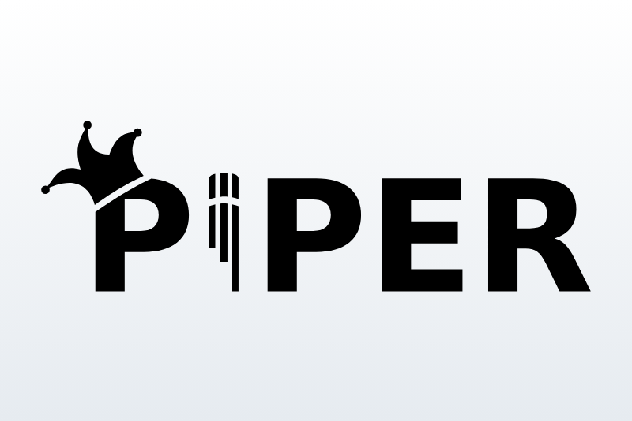

# Piper (Wyoming) for Gladys Assistant

A [Gladys Assistant](https://gladysassistant.com) external integration that
gives Gladys a **local voice**: [Piper](https://github.com/rhasspy/piper), or
any text-to-speech server speaking the
[Wyoming protocol](https://github.com/OHF-Voice/wyoming) of Rhasspy and Home
Assistant (Kokoro, XTTS, MaryTTS bridges…). No account, no cloud.



## What it does

- Registers as a **text-to-speech provider** (Gladys 5.3): choose it in
  Integrations → Artificial Intelligence → Voice, and the "Play a
  notification" scene action speaks through it on your speakers.
- Picks the voice from the language of Gladys (French, English, German,
  Spanish) among the voices the server offers, or follows your ordered list
  of preferred voices (`name:speaker` for multi-speaker voices).
- Builds MP3 (64 kbit/s mono, pure JavaScript encoder) or WAV clips, always
  under the 5 MB Gladys accepts (long WAV clips are resampled down).
- Sends long texts piece by piece: when the server is too slow for the 30 s
  Gladys waits, the beginning of the announcement speaks, and the server is
  not left synthesizing the rest for another minute.
- Shows the server state in Supervision, fires the **Voice server
  unreachable** / **Voice server back** scene triggers, and offers **Test the
  voice** and **Show the voices** buttons.

User documentation: [English](docs/en.md), [Français](docs/fr.md),
[Deutsch](docs/de.md), [Español](docs/es.md).

## Requirements

- Gladys Assistant **5.3.0** or later.
- A Wyoming text-to-speech server reachable from Gladys, for example:

  ```bash
  docker run -d --name piper -p 10200:10200 -v piper-data:/data \
    rhasspy/wyoming-piper --voice fr_FR-siwis-medium
  ```

## Installation

In Gladys: **Integrations → Install from GitHub**, then enter
`https://github.com/guim31/gladys-wyoming`. Fill in the server address, save,
and select the voice in Integrations → Artificial Intelligence → Voice.

## Limits

- Gladys truncates texts at 2,000 characters and waits 30 s for the clip.
  Measured on a mini PC (Piper `fr_FR-siwis-medium`, CPU shared with other
  services): 2,000 characters take about 40 s to synthesize, so about 50 s of
  the 2 minutes of speech fit; a Raspberry Pi speaks less of it.
- The voice assistant of Gladys stays text-only with a local voice (the LAN
  `http://` clip is blocked in the HTTPS page the microphone needs): this
  voice serves the scene announcements.
- No speed setting: the Wyoming protocol has none (Piper's `length_scale` is a
  server option).
- Tested against a real `rhasspy/wyoming-piper` server in Docker; not yet on a
  Gladys instance with real speakers: **feedback welcome**.

## Development

```bash
npm ci
npm run format:check && npm run lint && npm test
```

The tests replay the bytes of a real Piper server (`test/fixtures/piper-*.bin`)
through a fake Wyoming server cut into random TCP pieces, against the SDK's
fake Gladys. See [CLAUDE.md](CLAUDE.md) for the architecture and the project
rules.

## Credits

- [Wyoming](https://github.com/OHF-Voice/wyoming) protocol (MIT) and
  [wyoming-piper](https://github.com/rhasspy/wyoming-piper) (MIT), by Michael
  Hansen and the Open Home Foundation; the voice names and defaults follow the
  Home Assistant Wyoming integration (Apache 2.0).
- [Piper](https://github.com/rhasspy/piper) (MIT): the logo of the cover comes
  from its repository (`etc/logo.svg`).
- MP3 encoding: [@breezystack/lamejs](https://github.com/breezystack/lamejs)
  (LGPL-3.0, used unmodified as an npm dependency).

This project is not affiliated with Piper, Rhasspy, the Open Home Foundation
or Nabu Casa.

## License

[Apache-2.0](LICENSE)
